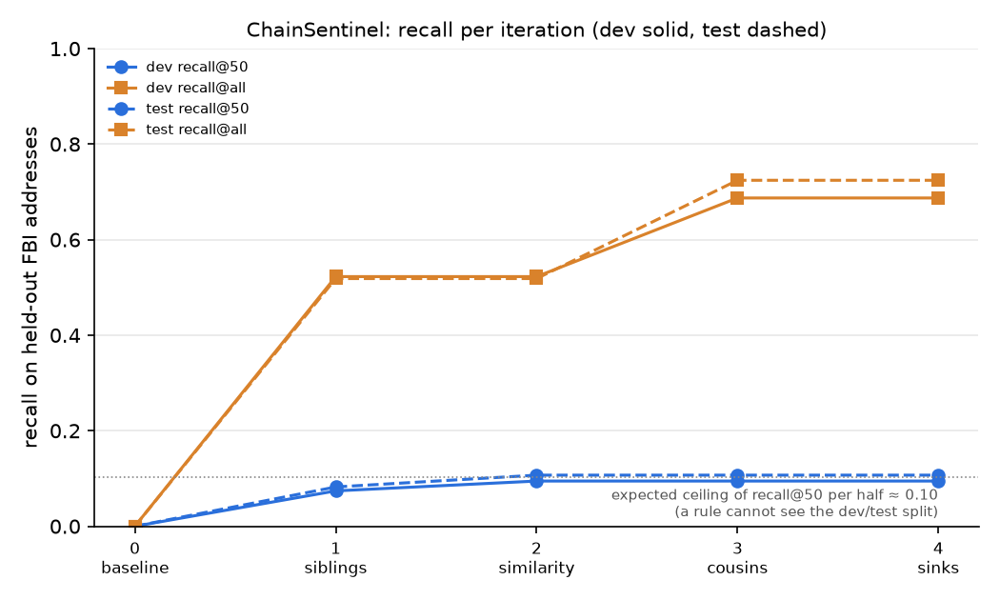

# ChainSentinel

A research loop that asks:
**given a few addresses that law enforcement tied to a theft,
how many of the other addresses can be recovered from public on-chain data alone?**

Built at the [Claude Impact Lab x Foresight Institute](https://luma.com/claude-wmbq), Berlin, 2026-11-07.

## Open problem

On 2026-10-29, more than $6 billion in crypto assets were stolen from Binance.
On 2026-10-31 the FBI attributed the theft to North Korea's TraderTraitor
and published 628 addresses holding or having held the stolen assets
(608 Ethereum, 19 Bitcoin, 1 Solana).

Tracing such funds is done mostly with closed commercial tools,
and there are few public, reproducible benchmarks for how well open heuristics do.
This repository turns the FBI list into one:

- 20% of the 608 Ethereum addresses are given to the loop as **seeds** (122 addresses, `seed=42`);
- the other 80% are **held out** (486 addresses) and only used for scoring;
- the loop proposes heuristics, ranks candidate addresses, and is scored by `recall@k` on the held-out set.

The result can be checked by computation:
every number in `results/` is produced by `chainsentinel.evaluate` from committed data.

## The loop

| Step | What happens | Where |
|---|---|---|
| Read | Planned: pick an untested heuristic from the literature and incident reports. **Not used today** — see below | `refs/README.md` |
| Explore | Look at the funding pattern of the seeds (no labels) and derive the next hypothesis from it | `JOURNAL.md` 13:20, 13:37 |
| Hypothesise | Write it down before running anything | `JOURNAL.md` |
| Test first | Write a failing test showing how the rule is used | `tests/` |
| Run | Rank candidates from the seeds and the cached transaction graph | `src/chainsentinel/rules/` |
| Check | Score against the held-out addresses | `src/chainsentinel/evaluate.py`, `results/iter_N.json` |
| Reflect | Inspect misses and top unlabelled candidates, queue the next idea | `JOURNAL.md`, `TASKS.md` |

State lives in files (`PROMPT.md`, `TASKS.md`, `JOURNAL.md`),
so the loop survives restarts:
`/goal continue the goal described in PROMPT.md`.

**What the loop actually did today.**
Iterations 1–4 came from exploring the data, not from the literature:
`refs/README.md` lists two clustering papers and the incident reports, but no journal entry cites them.
The literature step is the first gap to close (see Next steps).
The loop ran in two Claude Code sessions: setup and iterations 0–1, then a `/goal` session for iterations 2–4 and the final scoring.

## Results

Five iterations in one day (2026-11-07), each a single explainable rule.
Rules were designed on the **dev** half of the held-out addresses only;
the **test** half was scored once at the end (`--final`) for every iteration and is reported as is.
Full numbers: [`results/final.json`](results/final.json); per-iteration dev runs: `results/iter_N.json`;
rankings: `results/candidates_iter_N.csv`; reasoning and every variant tried: [`JOURNAL.md`](JOURNAL.md).



| iter | rule | candidates | dev r@50 | test r@50 | dev r@200 | test r@200 | dev r@all | test r@all | listed precision_lb@50 |
|---|---|---|---|---|---|---|---|---|---|
| 0 | [`baseline`](src/chainsentinel/rules/baseline.py): 1-hop neighbours of seeds | 118 | 0.000 | 0.000 | 0.000 | 0.000 | 0.000 | 0.000 | 0.00 |
| 1 | [`siblings`](src/chainsentinel/rules/siblings.py): other recipients of the seeds' funders | 482 | 0.074 | 0.082 | 0.313 | 0.263 | 0.523 | 0.519 | 0.76 |
| 2 | [`similarity`](src/chainsentinel/rules/similarity.py): + drop dust (poisoning), weight by amount like the seeds' | 331 | 0.095 | 0.107 | 0.403 | 0.346 | 0.523 | 0.519 | 0.98 |
| 3 | [`cousins`](src/chainsentinel/rules/cousins.py): + recipients of other distributors fed by the funders' funders | 1991 | 0.095 | 0.107 | 0.403 | 0.346 | 0.687 | 0.724 | 0.98 |
| 4 | [`sinks`](src/chainsentinel/rules/sinks.py): + demote candidates that sent ETH out | 1991 | 0.095 | 0.107 | 0.416 | 0.362 | 0.687 | 0.724 | 0.98 |

`r@k` = recall@k: the share of the 243 addresses of that half found in the top k.
*listed precision_lb@50* = share of the top 50 on the FBI list (dev or test half). It is a **lower bound**:
an address not on the list is unlabelled, not innocent.

**What we found.**

- **The funders are not listed, but the wallets they filled are.**
  None of the 118 addresses that paid the seeds is on the list (iteration 0).
  Their other recipients are listed far more often than chance: half of the held-out addresses are among them (iteration 1).
- **The top of the ranking is almost all listed.**
  From iteration 2 on, 49 of the top 50 candidates are FBI-listed addresses the rule was not given (23 in dev, 26 in test).
  The rule only uses the seeds and public transfers: amounts like the seeds', no dust, a funder that mostly paid seeds.
- **Reach comes from going one hop up and back down.**
  The funders' own funders paid other distributors; their recipients add 40 dev and 50 test addresses.
  Recall@all rises from 0.52 to 0.69 (dev) and 0.72 (test).
  Over the whole held-out set, 343 of 486 addresses (71%) are in the 1991 candidates.
- **Test agrees with dev.** The test half is within 6 points of dev everywhere (largest gap at r@200: 0.403 vs 0.346) and higher on recall@all,
  so the dev-driven choices do not look overfitted.

**What failed, and why.**
The session goal was dev recall@50 ≥ 0.15. Iterations 2, 3 and 4 all failed to reach it, each for a stated reason (JOURNAL 13:39, 14:24, 14:49).
The common cause is structural.
Recall@50 is counted on one half of the held-out addresses, and which half an address belongs to is a hash that no rule can see.
So even a perfect ranking puts about half test addresses in its top 50:
**the expected ceiling is about 25/243 ≈ 0.10 per half**, and 0.15 would need ≥ 37 of 50 from one half (p ≈ 0.0005).
Iteration 2 sits at 0.095 (dev) and 0.107 (test), at that ceiling, with 49 of 50 listed.
The metric to improve next is reach (recall@all), not the top 50.
The 0.15 target was set by us before the session, without checking it against the split;
the loop found that it was out of reach (JOURNAL 13:37) instead of chasing it.

**Limits.**

- **Precision is a lower bound**, and the FBI list is a snapshot of 2026-10-31.
  The single unlisted address in the top 50 may simply not have been listed yet.
- **Circularity.** The FBI list was most likely built by following the same fund flows.
  High recall means we re-derived much of the investigators' tracing from 20% of their output, not that we found new actors.
- **Coverage choices.** Window 2026-10-27 to 11-01. Uncles capped at the 600 largest of 3181.
  Two parents and four uncles were treated as services (exchanges, routers, WETH) and not expanded.
  31% of dev and 28% of test remain unreached.
- **Services can still be candidates**: Binance's hot wallet enters iteration 3 at rank 368 (iteration 4 moves it down).
  A candidate list is a review queue, not a finding.
- **Selection on dev.** 11 variants were compared on dev for iteration 2, so dev numbers are optimistic. Test was used once.
- **Single split.** One seed sample (`seed=42`); variance over other samples was not measured.
- **One incident, one actor, Ethereum only.** No claim of generality.
- **No attribution.** Ranked candidates are addresses to review, never a statement about who controls them.

**Next steps.**
Make the literature step real: test the deposit-address and peel-chain heuristics from `refs/` as iterations.
Variance over seed samples (`seed=1..5`). A service filter before ranking.
Lift the uncle cap and widen the window, for the remaining ~30%.
Report recall@k on the whole held-out set next to the per-half numbers, so the top-k metric is not capped by the split.

## How to run

```shell
python -m venv .venv && . .venv/bin/activate
pip install -e '.[dev]'
pytest                                   # labels, split, evaluation and rule tests
python scripts/build_labels.py           # rebuild data/*.csv from the archived FBI alert
python scripts/run_iteration.py 4 sinks  # re-run a rule offline from the cached data (dev metrics)
python -m chainsentinel.evaluate results/candidates_iter_4.csv --final   # dev and test
python scripts/final_report.py           # results/final.json and results/recall_by_iteration.png
```

Fetching new transaction data needs an Etherscan API key in `.env` (see `.env.example`).
Evaluating the committed results needs no key.

## Data and sources

- FBI alert of 2026-10-31, archived by the Wayback Machine on 2026-11-07:
  `data/raw/fbi_alert_2026-10-31.wayback-20261107060018.html`.
  A work of the US federal government.
- Ethereum transaction data from the Etherscan API, cached in `data/raw/etherscan/` (files over 50 MB gzipped).
  Fetch scripts: `scripts/fetch_seeds.py` (`--hop2`, `--hop3`, `--hop4`), `scripts/fetch_candidates.py`.
- All data is public. No private or personal data is used.

## License

Code: [Apache 2.0](LICENSE). Text: [CC BY 4.0](LICENSE-CC-BY-4.0).
Donated to [Foresight Institute](https://foresight.org/) as part of the Claude Impact Lab.
